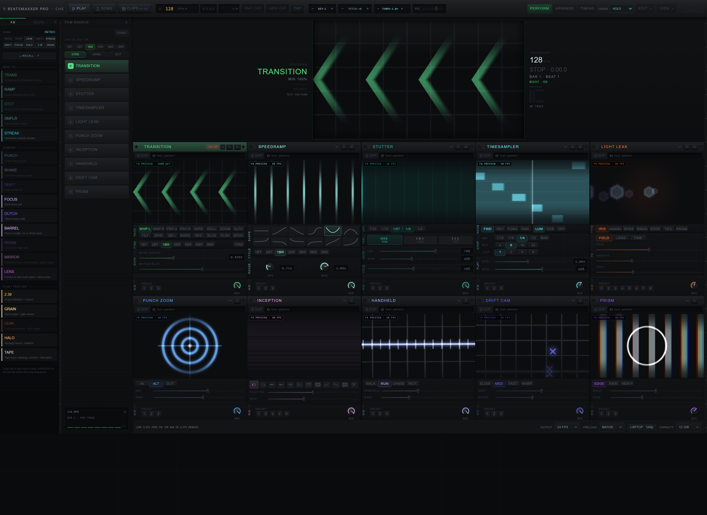
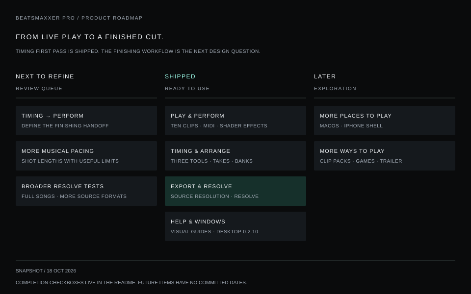

# Beatsmaxxer Pro

<p align="center">
  
</p>

Beatsmaxxer Pro is a music-driven video editor and live visual-effects instrument.
Shape cuts and playback timing around a song, perform with ten clip slots and
shader effects, then export a finished video or an editable DaVinci Resolve timeline.

**Stack**

- SvelteKit 5 and **WebGPU only** (WGSL; no WebGL or Three.js fallback)
- Bun, Vite, static web build (`adapter-static`)
- Windows desktop via **Tauri 2** (Rust shell only: window, `.env`, Essentia
  proxy, signed updates)
- Essentia rhythm/structure analysis with Web Audio fallback; SoundTouchJS for
  key, pitch, and tempo

**What it does**

- **Perform** — 19 WGSL effect modules, live previews, beat-quantized PGM cuts
- **Arrange and time** — song sections on a timeline; ramps, stutters, and jump
  cuts on the beat grid
- **Ship everywhere** — browser (Chrome/Edge), mobile performance shell, Windows
  app; browser acceptance scripts in CI and local gates

Not a generative-AI visualizer: effects are WGSL shaders on loaded video clips.

**Live:** [beatsmaxxing.com](https://beatsmaxxing.com) ·
**Windows app:** [latest release](https://github.com/gordo-v1su4/beatsmaxxer-pro/releases/latest)

## What it does

- **Perform** — ten live clip slots, 19 WGSL effect modules, and a program
  (PGM) monitor that cuts on the beat.
- **Arrange** — song sections detected from the track, laid out as a timeline.
- **Timing** — speed ramps, stutters and a triggered Time Sampler, recorded into a reviewable arrangement.
- **MIDI** — load a `.mid` file to drive trigger modules note by note.
- **Audio** — hosted Essentia rhythm/structure analysis with a Web Audio
  fallback; independent KEY / PITCH / TEMPO via SoundTouchJS.
- **Everywhere** — the same build runs in desktop Chrome/Edge, as a one-clip
  performance shell on phones, and as a Windows desktop app (Tauri 2).

## Quick start

```bash
bun install          # also installs svelte/ via postinstall
bun run dev          # http://localhost:5174
bun run test         # vitest
bun run test:local   # unit + build + browser gates (needs Chrome + WebGPU)
bun run build        # static site → svelte/build/
bun run dev:desktop  # Windows desktop shell (Tauri)
```

### QA mode (auto-load 8 clips + a song)

```bash
cd svelte && bash scripts/setup-qa-media.sh
bun run dev
# open http://localhost:5174/?qa=1&qaAutoplay=1
```

`?qa=1` auto-loads the song and eight rack clips on every refresh via
[`loadQaMedia.ts`](svelte/src/lib/qa/loadQaMedia.ts). Committed WebM fixtures
work on any machine.

## Stack

Slow-motion preparation can use the optional [GPU interpolation worker](media-worker/README.md). It queues clips serially, stores media in RustFS, and uses NVDEC → CUDA RIFE → NVENC to create 96 FPS sources from 24 FPS clips. The browser downloads verified renders before playback and keeps cuts on local resident WebGPU frames. Playback output defaults to 24 FPS. Processing errors remain visible and block playback, recording and export until resolved.

| Layer | Tech |
|-------|------|
| UI | SvelteKit 5 + runes |
| Render | **WebGPU only** (WGSL) — one `AppLoop` rAF drives `WebGpuEngine` |
| Decode | 10 slot-owned `HTMLVideoElement` pipelines in a shared pool; PGM reuses one |
| Rhythm | Hosted Essentia analysis + Web Audio fallback |
| Audio FX | SoundTouchJS (KEY / PITCH / TEMPO) |
| Desktop | Tauri 2 shell around the same web build (Windows) |
| Build | Vite 8 + Bun → static site via `@sveltejs/adapter-static` |

## Project structure

```text
svelte/src/
  routes/+page.svelte       Root page — picks the rack or the mobile shell
  lib/audio/                AudioEngine, Essentia, SoundTouch
  lib/rendering/webgpu/     WebGpuEngine, WGSL shaders and registry
  lib/runtime/              AppLoop, PGM director, timing and media runtimes
  lib/modules/catalog.ts    FX module catalog
  lib/components/           Rack, Arrange and Timing workspaces
  lib/mobile/               Phone performance shell
  lib/qa/                   QA auto-load + window.__BMX_QA__ hooks
desktop/                    Tauri 2 shell (Windows)
docs/                       Backlog, research, timing-workspace notes
```

## Docs

- [`docs/README.md`](docs/README.md) — docs index (backlog, research, workspace notes)
- [`svelte/docs/ARCHITECTURE.md`](svelte/docs/ARCHITECTURE.md) — runtime ownership and render/media data flow
- [`svelte/docs/SHIP_PLAN.md`](svelte/docs/SHIP_PLAN.md) — implemented work versus required release evidence
- [`svelte/docs/LOCAL_TESTING.md`](svelte/docs/LOCAL_TESTING.md) — browser acceptance gates
- [`svelte/docs/MODULES.md`](svelte/docs/MODULES.md) — register new effects
- [`desktop/README.md`](desktop/README.md) — desktop build and releases
- [`docs/deploy-app-vm.md`](docs/deploy-app-vm.md) — self-hosted app/API and Dockhand deployment
- [Portfolio case study](docs/portfolio-case-study/README.md) — interactive architecture walkthrough

## Roadmap



Updated October 18, 2026. Checked items are implemented; test scope is called out where it matters. The visual groups milestones; the checkboxes track the details. [Diagram source](docs/roadmap.html).

### Shipped · live performance and desktop

- [x] WebGPU render engine, 19 effect modules, live previews and a program (PGM) monitor.
- [x] Ten-slot clip rack and beat-quantized program cuts.
- [x] Hosted rhythm/structure analysis with Web Audio fallback; independent song key, pitch and tempo.
- [x] MIDI note triggers and a 16-step sequencer that can cut the program.
- [x] Phone performance shell, PIN access gate and hosted web deployment.
- [x] Windows desktop with signed auto-updates — [v0.2.10](https://github.com/gordo-v1su4/beatsmaxxer-pro/releases/tag/v0.2.10), including an installed-app update test.
- [x] Complete real-media demo projects available from the top menu.

### Shipped · Timing first pass and Arrange

- [x] Three Timing tools: speed ramps, stutters and Time Sampler, with timing-only controls.
- [x] Time Sampler plays normally between accepted triggers, captures a slice, completes its configured loops, then rejoins normal playback.
- [x] Both retrigger choices: **Finish Loop** and **Restart on Trigger**; continuous and triggered-sequence behaviors remain available.
- [x] Forward, reverse, ping-pong, random and structured slice patterns; slice count, rate, loops, groove and trigger chance controls.
- [x] MIDI/audio/beat trigger sources, density and minimum gaps; seeded **Balanced** and **Random** program cut selection.
- [x] Song sections on the beat-grid timeline, editable sections and reusable clip banks with section assignments.
- [x] Record program cuts and Timing settings, replay the saved take, and save/load portable arrangement JSON.
- [x] Section loops, section settings snapshots, timeline zoom/Fit All, full-height lanes and visible start/end boundaries.
- [x] Both sampler retrigger modes checked through recorded arrangement playback with real video clips.

### Shipped · video export and external editing

- [x] Export the whole song or a loop as video using original-resolution sources, selected output FPS and processed song audio.
- [x] Full-song native video tested at **1280 × 720 / 24 FPS**, including the ending and audio.
- [x] Optional **Resolve Timeline** export: ZIP with FCPXML, reference video, song audio, a source manifest and required prepared media; original files can be relinked from disk.
- [x] Import and render the actual two-mode app export in **DaVinci Resolve 21.1**: a **40.9-second** range checked against the browser reference for picture and audio sync.
- [x] Compact in-app Help with real screenshots, thin-line diagrams, sampler examples and separate video/arrangement/Resolve instructions.

[Resolve format and measured test scope](docs/research/resolve-timing-interchange.md) · [Help work and remaining review questions](docs/plans/help-timing-review.md)

### Next · refine the first pass

- [ ] Define how a Timing first pass carries into a Perform finishing pass.
- [ ] Add deliberate shot-length variation with useful minimum/maximum lengths, independently from effect motion.
- [ ] Continue reviewing Time Sampler behavior with real music and clips; refine controls and explanations where needed.
- [ ] Extend Resolve acceptance to full-song timelines and more media/frame-rate combinations.
- [ ] Decide how Perform shader looks should reach an external editor; editable shader interchange is not implemented.
- [ ] Expand ready-made clip packs beyond the complete demo projects.

### Later · platforms and experiments

- [ ] macOS desktop app.
- [ ] iPhone native shell around the phone performance view.
- [ ] New splash animation.
- [ ] Game mode — cut and hit effects on the beat, with scoring.
- [ ] Spec trailer — a web-series world about future DJs, with a *Total Recall* feel.

## Requirements

- **Chrome / Edge 113+** or **Safari 18+** with WebGPU enabled
- **Bun** for installs and scripts

## License

[MIT](LICENSE). Third-party code keeps its own license — notably
[SoundTouchJS](https://github.com/cutterbl/SoundTouchJS) (MPL-2.0) by Steve
"Cutter" Blades, based on Olli Parviainen's [SoundTouch](https://www.surina.net/soundtouch/).
See [`THIRD_PARTY_NOTICES.md`](THIRD_PARTY_NOTICES.md).
