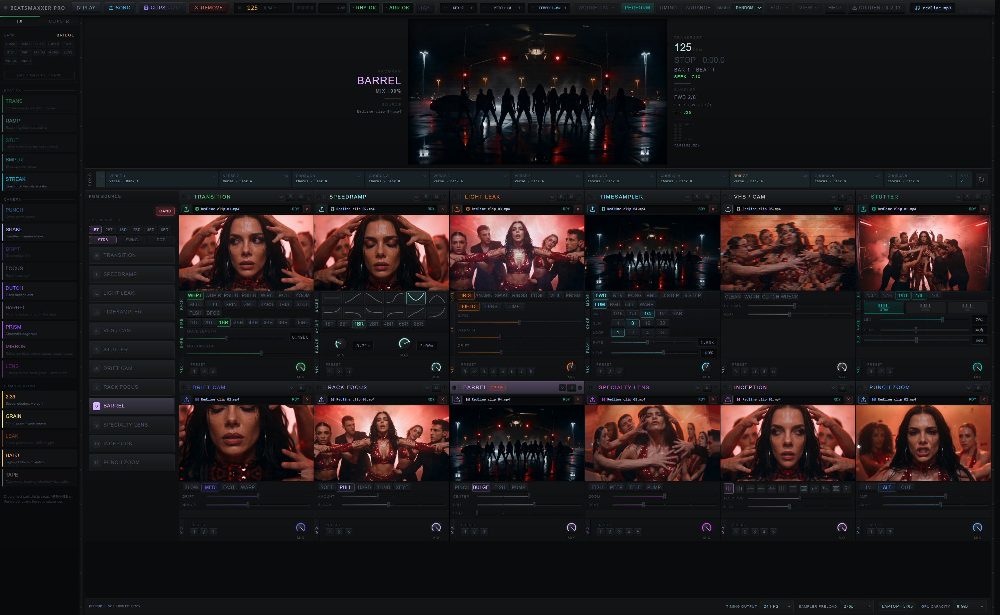

# Native desktop playback and twelve-slot layout

Tested in the packaged Tauri debug executable with the production frontend on
Windows/WebView2, using the public Redline workflow, twelve loaded slots, RANDOM
PGM cuts, 270p sampler preload and a 12 GiB shared resident-memory ceiling.
These measurements use the native WebView's CDP endpoint, not a substitute
Chrome instance. The installed public release is a separate artifact.

## Reproduced causes and changes

- PGM prewarm could pause and park a playing source at zero. It now waits for
  readiness without changing the committed video's clock or playback state.
- Incoming bank clips warmed at zero and then sought after publication. They
  now warm at their incoming live target; a slow decoder catches up while it
  is still hidden. The handoff preserves controlled-effect clock ownership.
- TimeSampler could remap its slices only after publication of a different
  source duration. Incoming source projection is now pure and identity-aware.
  On desktop, its slice jumps select GPU-resident original frames instead of
  repeatedly seeking a live decoder. Repeated sources share a bank. This path
  does not request interpolation or use a Canvas2D pixel scaler.
- Inactive Timing could retain pending uploads. Leaving Timing now cancels
  unfinished resident loads. Completed ramp caches remain reusable; a later
  review fix releases sampler-only banks before Perform allocates its copies.
- Resident banks allocated only ten independent output surfaces. They now
  support all twelve rack slots, with a shared upload queue per GPU device.
- Rack-only scaling left the toolbar and PGM rail too large. A single surface
  now fits Perform and Timing, including their rails and toolbar. All twelve
  PGM buttons fit; the unused bottom-left BPM meter is removed.

## Validation

- 1,093 unit tests passed; eight existing tests skipped. Svelte check: zero
  errors and warnings. Desktop frontend and native debug build passed.
- Two consecutive 60-second native playback runs passed the hold-detection
  gate across section/bank changes. Reports: [run 1](native-run-1.json) and
  [run 2](native-run-2.json). A further [120-second run](native-run-120s.json)
  on the 0.2.13 candidate also passed, covering repeated bank returns.
  The gate allows 150 ms between source frames for
  ordinary modules, 250 ms for SpeedRamp, and deliberate STUTTER holds.
  Resident TimeSampler is measured using selected source-frame identities,
  not a continually increasing timeline counter or its paused fallback video.
- Review hardened the gate to count the first-frame delay and the unfinished
  gap at the end of sampling. The [reviewed 120-second run](native-run-reviewed-120s.json)
  passed that stronger check, including idle Timing uploads and sampler readiness.
  The earlier runs above predate the terminal-gap check.
- A [negative native probe](native-negative-freeze.json) delivered two source
  callbacks, then suppressed the remaining callbacks. The stronger gate correctly
  rejected the 2.95-second unfinished gap. This is an expected failure artifact,
  not a playback result; the callback method was restored afterward.
- A [one-time sampler upload failure](native-sampler-retry.json) exposed the
  native retry action. Retrying recovered the failed bank without replacing
  healthy banks; preload was restored to 270p afterward.
- Browser decode-drop counters are included in the reports. Passing this gate
  does not mean zero dropped frames or certify arbitrary media and hardware.
- Native Timing exit changed 15 pending banks / 105,753,600 allocated bytes to
  zero pending / zero allocated bytes. Re-entering and completing preparation
  used 7,054,387,200 bytes; ready caches remained on exit with no pending jobs.
- At a 1920 × 1181 CSS-pixel native viewport, all twelve PGM buttons were
  visible. Expanded Timing controls ended at the viewport bottom and fitted
  with a uniform scale of approximately 0.926.
- A native GPU scaling probe checked four known source colors, orientation,
  viewport offset and untouched atlas pixels with GPU readback. All matched.
  Readback was diagnostic only; production scaling stays on the GPU.

## Current-source follow-up

**Latest native acceptance still fails intermittently.** The rebuilt 0150c43
executable [failed a 120-second repeat](final-native-0150c43-120s.json) with
simultaneous ordinary-source gaps of 150.1–216.7 ms around song second 64.4.
Main-loop maximum was 116.6 ms. No local build or unit test overlapped this run;
the event occurred away from a section handoff. Earlier clean runs below do not
establish consistent final-source acceptance.

A fifteen-second replay under CPU profiling passed. A subsequent 120-second
trace correlated seeks/waits, long tasks and focus/visibility. The page stayed
visible and focused, with no reported long tasks. Its only failed source gap
was a 179.1 ms leading gap on top-0 while seeking after the diagnostic jump to
60 seconds. The original steady-playback hitch did not recur. Raw profile and
event files remain under ignored output/. No browser flag, decoder-sharing or
quality change was shipped from these probes.

CI passed and Greptile reviewed 0150c43 at 5/5. Runtime acceptance remains open.
The required full OCR re-review, Actions run 39827525357, timed out after
repeated Kimi HTTP 429 five-hour usage-limit errors; its result JSON was empty.
It does not satisfy the complete-review gate.

A subsequent [four-way native GPU comparison](native-fx-comparison.md) passed
baseline, immediates-only, shared-bindings-only and both-enabled checks. That
evidence is recorded with drops, instrumentation differences and the unresolved
earlier failure; it is not a speed ranking or a claim that the hitch is fixed.

The c259d76 native debug executable was rebuilt from the shared frontend and
tested with the public twelve-slot Redline Perform demo, RANDOM order and 1BT
cuts. The [isolated 120-second repeat](current-native-isolated-120s.json) passed
every source-cadence check: maximum 100.1 ms for each slot, three source swaps
per slot, main-loop maximum 83.4 ms, twelve decoders and inactive Timing with
zero pending work. Decoder drops totaled 55; this is not a zero-drop claim.

An [earlier run](native-overlap-120s.json) failed with gaps up to two seconds.
Local unit/type-check compilation overlapped its final interval. It is retained
as a failed measurement with that confound, rather than silently discarded.
The clean repeat ran without concurrent local builds or tests.

The native frontend and executable compiled successfully. Full smoke packaging
stopped at updater signing, so no installer-smoke pass or published update is
claimed. The subsequent first-scene recall priming fix has unit/type/build
coverage. Its native executable rebuild passed; its playback repeat is above.



## Repeat the playback gate

Launch the native app with WebView2 remote debugging on port 9633, load twelve
representative clips, and start Perform playback. In PowerShell:

```powershell
$env:DESKTOP_SAMPLE_MS = '60000'
$env:DESKTOP_ALLOW_SCENE_CHANGES = '1'
$env:DESKTOP_REPORT = '.artifacts/desktop-playback.json'
bun svelte/scripts/verify-desktop-playback.ts
```

The gate attaches to the native Tauri origin and rejects an unloaded rack,
inactive transport, or active Timing workspace. It records clip replacements,
actual decoded/selected source-frame gaps, dropped frames and sampler residency.
