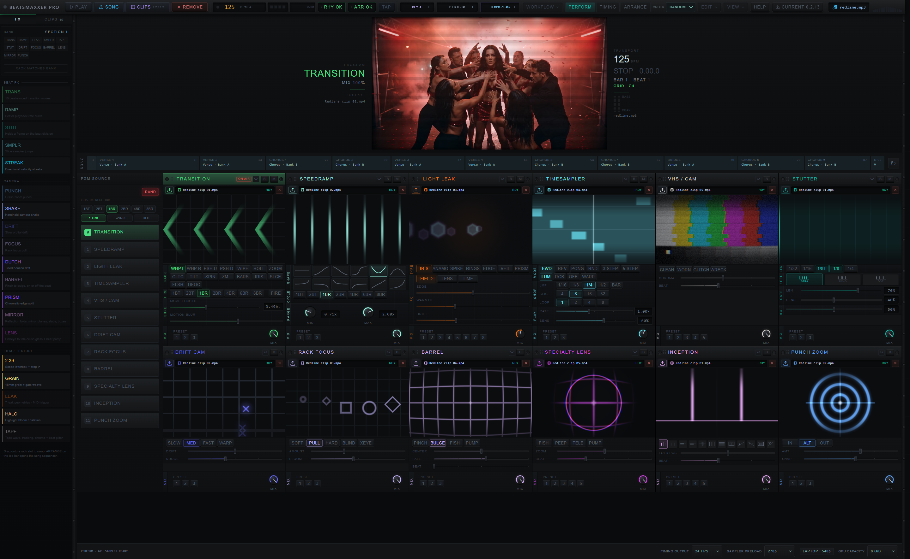

# Installed desktop demo availability

The installed 0.2.13 executable reproduced the WORKFLOW message "Demo files are
unavailable" after the user updated. This was the installed application under
AppData, not the repository debug executable. Retry initially retained the error.

The configured application origin was correct and its published manifest
returned HTTP 200 without redirects. After restarting the empty installed app
with WebView diagnostics, the native `hosted_demo_request` returned a 4,039-byte
ArrayBuffer containing the reviewed `redline-complete-v1` manifest. No media,
server, configuration or application binary was changed to recover access.
WORKFLOW then loaded the complete Perform demo: twelve slot-owned decoders,
every source at readyState 4, inactive Timing and zero pending Timing work.
Playback was left stopped for the user.

The original exception is not recoverable: TopBar discarded it and displayed
the same message for a pending request, rejected request or invalid manifest.
The initial failure's transport/startup cause remains unproven. Successful
requests after restart do not establish which cause applied.

The follow-up change shares concurrent catalog checks and retries transport
failures, HTTP 408/429 and server errors, at most three attempts with 300/900 ms
delays. Validation errors and permanent HTTP failures are not retried. The menu
shows a checking state while pending, and preserves the actual error if all
attempts fail. Explicit retry starts a fresh request after failure.

Verification: the transient-recovery and retry tests first failed against the
single-attempt implementation, then passed with the change. All 1,119 unit
tests passed (eight skipped), Svelte check reported zero errors/warnings and
the production frontend build passed. This hardening change has not yet been
installed in the user's 0.2.13 application.

[Installed-app diagnostics](installed-demo-restored-013.json)

