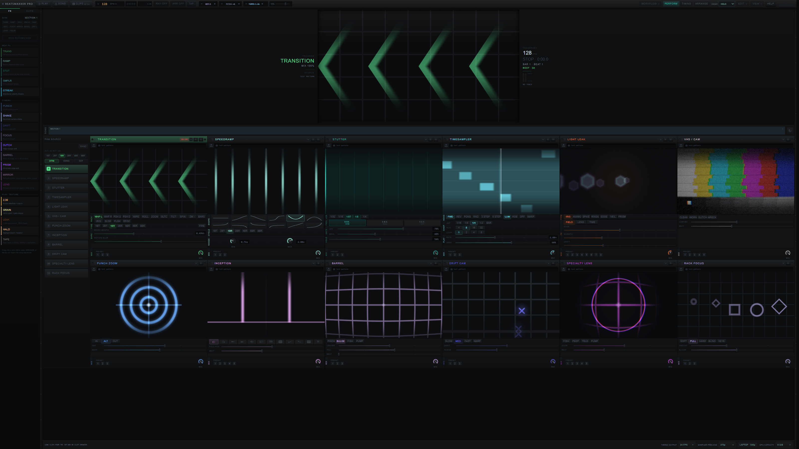

# Web playback verification — October 22, 2026

Local development and compiled-web candidates, in-app Chromium browser, public
Redline Perform workflow, twelve loaded slots, cuts every beat, 270p sampler
preload. These are local measurements, not evidence of a deployed production fix.

## Compiled web and remaining checks

The same working tree was compiled with `bun run build` and served by the real
`runtime/server.ts` handler on 127.0.0.1:5174. No Vite development runtime or
temporary clock wrappers were present in this check.

- [RANDOM, 120 seconds](production-random-120s.json): all twelve source-cadence
  checks passed, including three source swaps per slot. Ordinary source maximum
  gaps were 116.6–149.9 ms; SpeedRamp reached 100.1 ms and resident TimeSampler
  99.9 ms. Main-loop maximum gap was 99.9 ms. Decoder drops were nonzero, including
  39 for SpeedRamp; passing is not a claim of zero dropped frames.
- [LINEAR, 30 seconds](production-linear-30s.json): one source swap per slot.
  Lens had one 166.6 ms gap at song second 174.18, exceeding the unchanged 150 ms
  threshold. The other source checks passed.
- [LINEAR including song return, 120 seconds](production-linear-loop-120s.json):
  the song return itself completed, but a bank handoff had ordinary gaps up to
  200.1 ms. The whole-rack check failed.
- A [future-ramp forecast experiment](ramp-forecast-probe-120s.json) passed a
  short targeted handoff, then failed extended playback badly near the final
  bank: up to 950.1 ms. That speculative preloading was removed. It is not part
  of the implementation. This result is not a final-source playback result.

Two measured fixes are included:

1. Incoming ordinary clips prepare serially during the eight beats before a
   changed scene. They decode the future landing and remain paused until needed.
   The normal commit transaction takes over the prepared decoder and URL; it
   releases the outgoing decoder before starting the replacement. Future
   SpeedRamp and TimeSampler sources keep their own preparation/clock paths.
   Traces showed ten ordinary sources ready before bank boundaries and no more
   than twelve playing decoders during handoff, down from nineteen initially.
2. A CPU profile identified `RackViewportFit.fit` as the caller of every hot
   `getBoundingClientRect` sample. Each ON AIR badge mutation reset zoom and forced
   two full workspace layouts. ResizeObserver now owns size changes, while the
   mutation observer only discovers mounted/unmounted layout blocks. The same
   five-second live probe changed from [20 measurements](layout-before.json) to
   [zero](layout-after.json), without disabling fitting.

The [development run after the layout fix](development-layout-fixed-120s.json)
still failed two slots. A [temporary bounded clock-correction experiment](phase-probe-120s.json)
did not consistently improve delivery and was restored; it is not shipped.
Compiled-web acceptance is therefore recorded separately from development runs.

The first incoming original in that slow preparation is 1280×720 H.264 at 24 FPS,
340 frames, with keyframes at 0, 1.5, 4.125, 6.5, 8.041667 and 12.166667 seconds
(local `ffprobe` packet metadata). Its final-bank target is approximately 11.04
seconds, requiring decoding forward from the earlier keyframe. Cached compressed
bytes are not a GPU-resident frame bank. Traces first showed foreground waiting
while only one hidden candidate was present, so a presumed fixed concurrent
decoder limit has not been established as the cause. The decode/seek contention
path still needs isolation; raising the resident-memory ceiling is not a proven
fix. No source transcoding or proxy-quality change was shipped.

Review follow-up adds loop-start source positions to lookahead, establishes
incoming clock ownership after effect-bank changes, and preserves a newly
controlled slot's warm clock at commit. Incoming SpeedRamp still follows its
mapped-clock preparation at the boundary. Timing releases completed sampler-only
resident banks on exit while retaining banks also needed by its ramps.

The gate now rejects module-layout changes during a sample: initial Stutter or
SpeedRamp exemptions cannot follow an ordinary effect into that slot. A
[negative module-layout probe](negative-module-layout.json) detected the changed
effect despite the original Stutter exemption. A [missing-source probe](negative-missing-source.json)
returned a serializable failed slot instead of throwing. Both probes restored
their temporary diagnostic wrappers and are expected failures.

Current unit suite: 1,115 passed, eight skipped. Svelte check: zero errors and
warnings. Production build passed. Final native regression and published-site
verification remain open. The branch is not release-ready on long-run web evidence.

At a 1920×1000 compiled-web viewport, all twelve PGM buttons remained visible.
Expanding Timing's accepted-burst timeline initially exposed a missing observer
target: the footer reached 1069.7 px. Observing `.timing-panel` fixed the same
interaction: [footer bottom 999.33 px, all twelve PGM buttons visible](timing-expanded-fit.json),
with a uniform scale of 0.856516. [Expanded Timing screenshot](timing-expanded-fit.png).

## Results so far

- [Baseline, 60 seconds](baseline-60s.json): TimeSampler used live decoder seeks;
  its maximum observed source-frame gap was 683.6 ms. Ordinary slots also
  exceeded the 150 ms threshold. The whole-rack check failed.
- [Resident sampler, 120 seconds](resident-sampler-120s.json): TimeSampler used
  the GPU frame bank, with a maximum 150 ms gap and two prepared original-frame
  banks using 319,334,400 bytes. All twelve slots changed source three times.
  Other slots still had long gaps, up to 1,150.1 ms for Transition. The whole-rack
  check still failed. The sampling windows differ; this is not a controlled
  aggregate performance comparison.
- The largest ordinary-source gaps clustered around transport seconds 75–76,
  after a bank return. Main-loop rAF maximum gap was 133.4 ms, so a completely
  blocked main loop does not explain the full source-frame delay.
- [Fresh corrected-showcase run, 120 seconds](showcase-120s.json): twelve slots,
  three actual source swaps each, one-beat random cuts. Maximum ordinary gaps
  were 300–566.8 ms; SpeedRamp reached 633.3 ms and resident TimeSampler
  199.9 ms. The unchanged whole-rack thresholds still failed. rAF maximum gap
  was 166.7 ms. Test playback was stopped after sampling.

The desktop-only guard around PerformTimeSamplerFrames was removed so the web
uses the same GPU-resident original-frame sampler. Inactive Timing was confirmed
inactive with zero pending banks in both runs. This does not yet prove the web
playback issue resolved.

## Showcase correction

Fresh defaults and demo section banks no longer select Motion Streak, Halation,
Anamorphic or Film Grain. The showcase includes VHS, Barrel, Specialty Lens and
Inception. Existing operator-authored workflows remain explicit saved choices.
VHS can occupy either row; the QA MIDI fixture now targets VHS instead of the
no-longer-default Handheld slot.

VHS has a distinct broadcast calibration subject. Barrel and Lens use soft,
analytically feathered reference lines; their real effect shaders distort those
subjects. Both complete idle and video shader variants compiled without GPU
errors after the change. A derivative-based attempt was rejected by WGSL
uniform-control-flow validation and was replaced before saving these results.

At the showcase-change commit, 1,094 unit tests passed and eight were skipped;
the production build passed. The demo
integration test also checks all section banks and stored replay snapshots for
twelve unique effects and the four showcase replacements. Browser acceptance,
published-site verification and release propagation remain open.

## Original hypotheses and next diagnosis

Ranked hypotheses to isolate before further playback edits:

1. Concurrent incoming decoder warmup competes with the outgoing bank, creating
   decoder/presentation backlog around handoffs.
2. Other open app tabs retain decoder/render work and affect the measured tab.
3. GPU presentation/shader load contributes to main-loop gaps but does not by
   itself account for the longer source-frame gaps above.

Repeat with only the measured app active, compare a no-swap interval against
bank crossings, and record candidate/outgoing decoder lifetimes. LINEAR and
RANDOM should then be compared under the same prepared-bank workload.

Those isolation/comparison runs above confirmed smooth warm steady intervals,
reduced playing-decoder overlap and the layout-measurement bug, but did not
resolve every decoding stall. Next isolate the final-bank paused seek and its
foreground drift-correction cascade with a short reproduction. Preserve source
resolution and the frame-gap limits while comparing alternatives.
